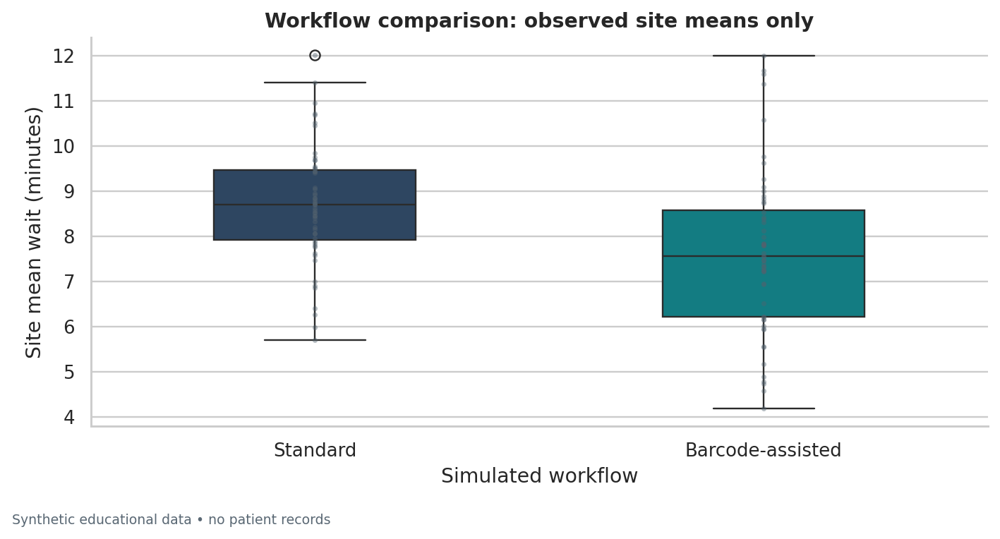
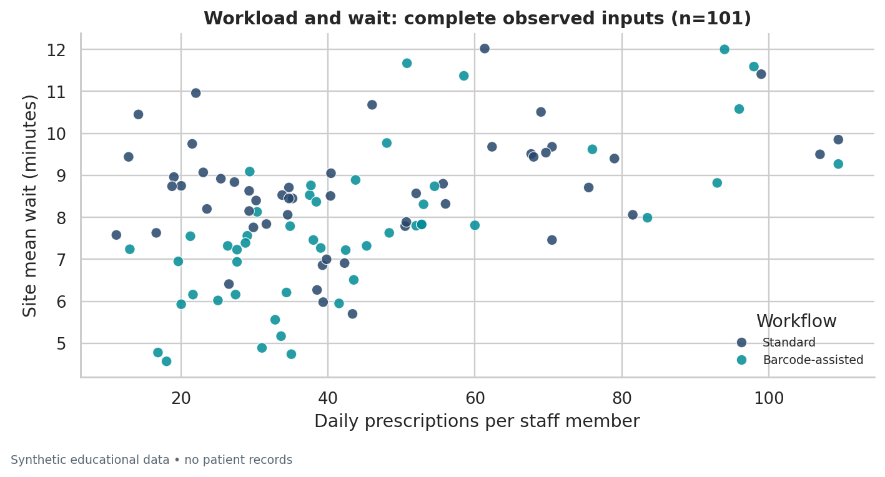

# Data Science Fundamentals Assessment

## Pharmacy operations analytics | B.Pharm → Data Analytics

A complete beginner-level assessment portfolio covering Python, NumPy, Pandas, statistics, data types, cleaning, EDA, visualization, testing and Git. The real-world **context** is pharmacy operations; the **data are entirely synthetic**.

**Local verification:** 16 practical exercises executed; **48 tests passed**; seven EDA charts generated. The executed notebook, actual output logs and dependency versions are included. This is local evidence, **not a claim that GitHub Actions has run**.

> **Safety and honesty:** no patient data, clinical advice or measured business results are used. The generator deliberately includes a workflow effect. Statistics demonstrate methods, not real-world efficacy or an operational recommendation.
>
> **GitHub repository:** [appureddy1102-cloud/pharmacy-data-science-assessment](https://github.com/appureddy1102-cloud/pharmacy-data-science-assessment) — **private**. Sign in with the owner account or obtain collaborator access. The report includes the same repository location. No cloud CI run is claimed. See [the access and upload guide](docs/GITHUB_UPLOAD.md). Revoke any access token exposed in chat; no token is stored in these files.

## What this project demonstrates

- Python variables, types, lists, tuples, sets, dictionaries, conditionals, loops, functions and specific exception handling.
- NumPy arrays and vectorized operations; Pandas DataFrames, filtering, grouping and dtype management.
- Mean, median, mode, sample variance/SD, probability, normal distributions, covariance, correlation and Welch hypothesis testing.
- Numerical, categorical, nominal, ordinal, discrete, continuous, structured and unstructured data.
- Audited missing-value handling, exact deduplication, invalid-row quarantine, EDA and labeled plots.
- Clean modular code, documentation, data validation, tests, Git workflow and credential hygiene.

## Deliverables

| Deliverable | Location |
|---|---|
| Professional Word report | [reports/Data_Science_Fundamentals_Assessment.docx](reports/Data_Science_Fundamentals_Assessment.docx) |
| Executed notebook | [notebooks/01_fundamentals_assessment.ipynb](notebooks/01_fundamentals_assessment.ipynb) |
| Practical Python files | [exercises/](exercises/) |
| Exact sources and captured outputs | [docs/PRACTICAL_EXERCISES.md](docs/PRACTICAL_EXERCISES.md) |
| Statistical analysis | [docs/ANALYSIS_FINDINGS.md](docs/ANALYSIS_FINDINGS.md) |
| Sample CSVs and dictionary | [data/](data/) and [docs/DATA_DICTIONARY.md](docs/DATA_DICTIONARY.md) |
| Seven EDA visualizations | [reports/figures/](reports/figures/) |
| Setup and reproducibility | [docs/RUN_GUIDE.md](docs/RUN_GUIDE.md) |
| GitHub creation/upload instructions | [docs/GITHUB_UPLOAD.md](docs/GITHUB_UPLOAD.md) |
| Assessment checklist | [docs/SUBMISSION_CHECKLIST.md](docs/SUBMISSION_CHECKLIST.md) |

## Quick start

Use Python 3.13 (tested: 3.13.16) and Git. From the extracted repository root:

```bash
python -m venv .venv
# Windows PowerShell: .\.venv\Scripts\Activate.ps1
# macOS/Linux: source .venv/bin/activate
python -m pip install -r requirements.txt
python -m pip install -e . --no-deps
python scripts/verify_submission.py
```

The full verification refreshes the synthetic sample, analysis, all exercise outputs, tests, executed notebook, documentation and Word report. It stops on failure. See [RUN_GUIDE.md](docs/RUN_GUIDE.md) for individual commands, platform-specific activation and troubleshooting. JupyterLab is an optional interface; headless notebook execution is included through nbclient/ipykernel.

To run only the existing-data analysis and tests:

```bash
python scripts/run_assessment.py
python -m pytest -q
```

## Dataset and cleaning policy

One record represents one **fictional independent pharmacy**, not one prescription or patient. Seed 2026 produces 120 sites, then adds five exact duplicate rows. The CSV has 125 raw rows. Cleaning removes 5 exact duplicates and quarantines 3 records with invalid ID, date or workflow, leaving **117 sites**.

- Raw data stay unchanged when the analysis runs; the sample generator intentionally recreates them.
- Invalid numeric values become missing and are counted in the audit.
- Designated non-outcome numeric columns receive flagged median imputation; count medians are rounded.
- **Missing wait outcomes are never imputed:** 6 remain missing; 111 observed outcomes enter the primary comparison.
- Workload/wait correlation uses only **101 complete observed pairs**, excluding imputed workload inputs.
- Stock-risk categories use arbitrary teaching cutoffs (Low >=95%, Medium >=90% and <95%, High <90%). Risk counts include 4 stock imputations and are not validated healthcare quality indicators.
- Region labels are contextual only; Unknown is retained rather than guessed.

Full decisions: [cleaning_audit.json](reports/cleaning_audit.json), [THEORY.md](docs/THEORY.md) and [DATA_DICTIONARY.md](docs/DATA_DICTIONARY.md).

## Actual executed results

```text
SYNTHETIC PHARMACY OPERATIONS — EXECUTED RESULTS
Clean sites: 117; observed wait outcomes: 111
Wait mean = 8.147 min; median = 8.150 min
Sample variance = 2.732 min^2; sample SD = 1.653 min
Standard: n=55, mean=8.678, SD=1.309 min
Barcode-assisted: n=56, mean=7.625, SD=1.795 min
Welch difference (Standard - Barcode-assisted) = 1.054 min
95% CI = [0.463, 1.644] min
t=3.5375, df=100.657, p=0.000612561
At alpha=0.05: Reject H0 (simulation only; not a clinical claim).
Workload vs wait: n=101, r=0.4842, covariance=18.6331
P(site mean wait < 10 min | observed) = 99/111 = 0.8919
Missing wait outcomes were NOT imputed; correlation excludes imputed workload inputs.
This dataset is fictional and its generating formula includes a workflow effect.
```

**Interpretation:** the mean difference of 1.054 minutes is **Standard minus Barcode-assisted**, with a 95% CI from 0.463 to 1.644 minutes. At prespecified alpha=0.05 the two-sided Welch procedure rejects equal means in this simulation. The generating formula already included a workflow effect, so this is a worked statistical example, not evidence to adopt a real pharmacy system. A pharmacy-level mean is not an individual waiting-time distribution.

The workload correlation of 0.4842 is exploratory and does not establish causation. Median imputation can distort distributions; complete-case inference can be biased in real data. See [ANALYSIS_FINDINGS.md](docs/ANALYSIS_FINDINGS.md) for denominators, diagnostics and limitations.

## EDA examples





All seven charts are local files. They identify units, sample definitions and imputation policy; Q–Q diagnostics are separate for each workflow.

## Repository structure

```text
pharmacy-data-science-assessment/
├── README.md
├── requirements.txt              # tested, pinned dependencies
├── pyproject.toml                # editable Python package + tooling
├── .gitignore
├── docs/CI_WORKFLOW_TEMPLATE.yml # optional CI template; not an active workflow
├── src/pharmacy_ds/              # generation, cleaning, statistics, plots
├── exercises/                    # 16 runnable beginner practicals
├── scripts/                      # run, verify, notebook and report builders
├── tests/                        # schema, edge-case and numerical checks
├── notebooks/
│   └── 01_fundamentals_assessment.ipynb  # executed, embedded outputs
├── data/
│   ├── raw/pharmacy_operations_dirty.csv
│   ├── processed/pharmacy_operations_clean.csv
│   ├── processed/rejected_rows.csv
│   └── data_dictionary.csv
├── reports/
│   ├── Data_Science_Fundamentals_Assessment.docx
│   ├── figures/                  # seven PNG charts
│   ├── tables/                   # descriptive and workflow CSV tables
│   ├── cleaning_audit.json
│   ├── statistical_results.json and .txt
│   ├── exercise_outputs.json and .txt
│   ├── test_results.txt
│   └── execution / notebook / verification evidence
└── docs/                         # theory, dictionary, findings, upload guide
```

## Quality and reproducibility evidence

```text
................................................                         [100%]
48 passed in 1.92s
```

Tests independently check schema, accounting of rows, raw-data preservation, invalid values, flags, outcome missingness, category order, CSV round trips and agreement of the Welch statistic/CI with SciPy. See [test_results.txt](reports/test_results.txt), [notebook_execution.json](reports/notebook_execution.json), [execution_environment.json](reports/execution_environment.json) and [verification_summary.json](reports/verification_summary.json).

Use `python -m ruff check .` for lint and `python -m ruff format .` for consistent formatting. Pinned **requirements.txt** is the conventional lowercase dependency filename. Package metadata permits Python 3.11+, but this submission's recorded verification covers Python 3.13 only. No successful cloud CI run or external review is asserted.

## GitHub access and future updates

Repository: **[appureddy1102-cloud/pharmacy-data-science-assessment](https://github.com/appureddy1102-cloud/pharmacy-data-science-assessment)** (private). Invite your assessor through the repository's access settings if needed. Use browser-based authentication on your own computer for future changes:

```bash
gh auth login --hostname github.com --git-protocol https --web
gh repo clone appureddy1102-cloud/pharmacy-data-science-assessment
cd pharmacy-data-science-assessment
git status
```

Review edits, commit focused changes and push using your approved local authentication. Do not create another repository with the same name just to update this one. [GITHUB_UPLOAD.md](docs/GITHUB_UPLOAD.md) covers access, updates and publishing another copy. The optional CI configuration is at `docs/CI_WORKFLOW_TEMPLATE.yml`; enable it through GitHub's web editor or an appropriately authorized connection if required. No active workflow or successful cloud CI execution is claimed.

## Academic and professional use

Review and understand every solution before submission. Add personal academic details only if required and follow your institution's rules on assistance and attribution. No student identity, real study data, execution results or remote publication has been invented. No open-source license has been selected; choose an appropriate license before offering the project as open-source.

## References

The report and [docs/REFERENCES.md](docs/REFERENCES.md) cite the Python, NumPy, pandas, SciPy, NIST, PEP 8 and GitHub documentation consulted. All assessment-specific numerical outputs are locally computed from the included synthetic files.
